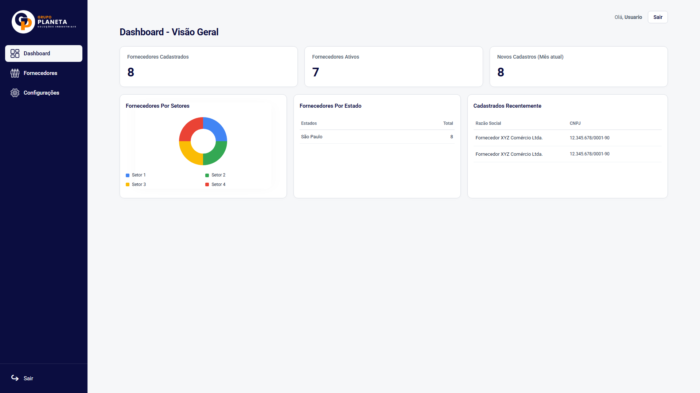
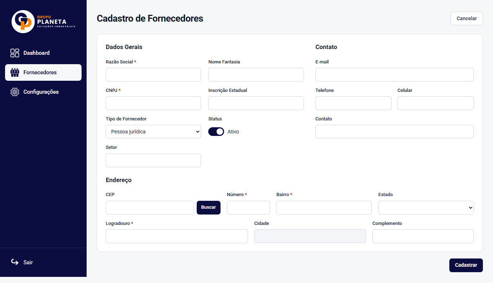
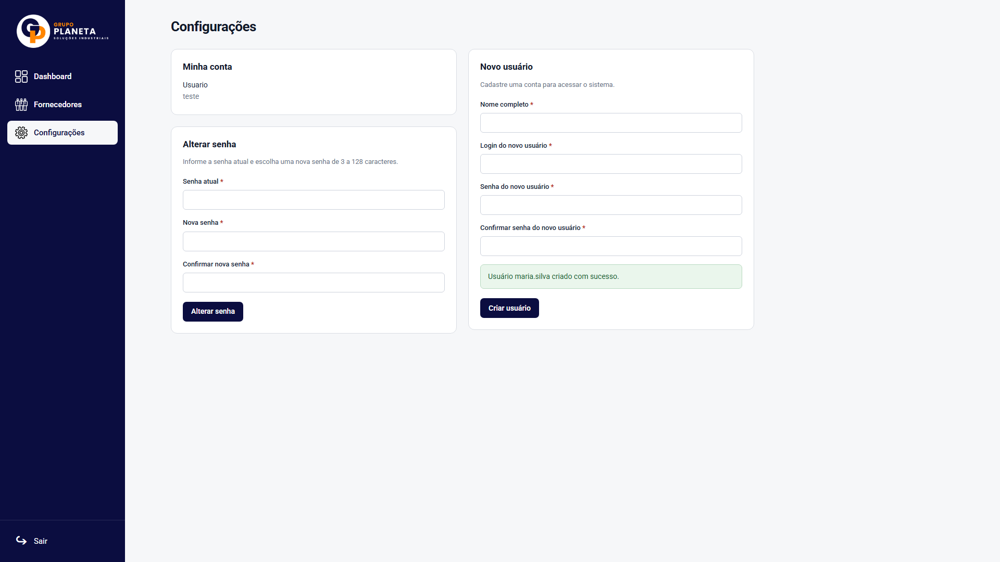

# Grupo Planeta — Gestão de Fornecedores

Sistema web para cadastrar, consultar, editar, ativar, inativar e excluir fornecedores, com autenticação, gestão de contas, cidades do IBGE e consulta de endereços pelo ViaCEP.

Desenvolvido em **JavaScript**, com **React + Vite** no frontend e **Node.js + Express + Prisma + MariaDB** no backend.

## Visão geral

- Dashboard com totais, fornecedores ativos, cadastros do mês, setores e estados.
- Cadastro de pessoa física e jurídica com validação de CPF e CNPJ, inclusive alfanumérico.
- Um endereço e um contato por fornecedor, com setor de atuação.
- Máscaras de documentos, CEP e telefones, com envio normalizado à API.
- Busca, filtros, paginação e checkbox **Apenas Ativos**.
- Exclusão permanente mediante digitação de **EXCLUIR**.
- Login por JWT, troca da própria senha e cadastro de novos usuários.
- Interface compacta e responsiva; saída pelo dashboard e pelo rodapé lateral.

## Telas

Imagens geradas com dados simulados, sem informações do banco local.

## Estrutura

~~~text
.
├── api-fornecedores/       # Express, Prisma, migrations, importação e testes da API
├── web-fornecedores/       # React, Vite, recursos visuais e testes de interface
├── docs/                   # Guias do sistema completo
├── .github/                # Modelo de pull request
├── CONTRIBUTING.md
└── README.md
~~~

Os dois módulos têm seu próprio package.json e package-lock.json. Execute os comandos npm na pasta do módulo correspondente; não existe um comando npm na raiz do conjunto.

## Começar

Ambiente validado com **Node.js 24.14.0**, npm e MariaDB local no Windows. Os testes de interface usam Microsoft Edge.

1. Configure o backend seguindo [o README da API](api-fornecedores/README.md).
2. Prepare o banco, importe as cidades e crie o primeiro usuário.
3. Configure o frontend seguindo [seu README](web-fornecedores/README.md).
4. Execute a API e o frontend em terminais separados.

~~~powershell
# Terminal 1
cd api-fornecedores
npm run dev
~~~

~~~powershell
# Terminal 2
cd web-fornecedores
npm run dev
~~~

Abra [http://127.0.0.1:5173](http://127.0.0.1:5173). Não há conta nem senha padrão distribuída com o projeto.

## Documentação

| Guia | Conteúdo |
|---|---|
| [Instalação completa](docs/INSTALACAO.md) | Dependências, ambiente, banco, primeiro acesso e execução |
| [Manual de uso](docs/MANUAL_DO_USUARIO.md) | Telas e operações do dia a dia |
| [Arquitetura](docs/ARQUITETURA.md) | Camadas, integrações, autenticação e limites atuais |
| [Banco de dados](api-fornecedores/docs/BANCO_DE_DADOS.md) | Models, colunas, relacionamentos e importação de cidades |
| [Referência da API](api-fornecedores/docs/API.md) | Rotas, parâmetros, exemplos e erros |
| [OpenAPI](api-fornecedores/docs/openapi.json) | Contrato importável no Postman e em ferramentas OpenAPI |
| [Primeiro usuário](api-fornecedores/docs/PRIMEIRO_USUARIO.md) | Inicialização de um banco sem contas |
| [Operação e diagnóstico](api-fornecedores/docs/OPERACAO.md) | Senha esquecida, banco, backup e problemas comuns |
| [Testes](docs/TESTES.md) | Comandos, cobertura e diferença entre dados reais e simulados |
| [Publicação no GitHub](docs/PUBLICACAO_GITHUB.md) | Preparação dos arquivos e organização do repositório |
| [Contribuição](CONTRIBUTING.md) | Convenções para alterações no projeto |

A [coleção do Postman](docs/postman/fornecedores.postman_collection.json) inclui as requisições do sistema. Preencha as variáveis localmente; nenhuma credencial real está incluída.

## Situação atual

O projeto foi desenvolvido para uso local. A publicação do código no GitHub não hospeda o sistema nem publica o MariaDB. Para servir o frontend compilado, é necessário configurar o encaminhamento de /api para o backend.

O frontend carrega as páginas de fornecedores para calcular indicadores e filtros. Não há perfis de administrador, recuperação por e-mail, refresh token ou revogação individual de JWT. Veja os detalhes na [arquitetura](docs/ARQUITETURA.md).

## Licença e recursos

Não há um arquivo LICENSE definido para o conjunto. O package.json da API contém a indicação ISC; uma licença unificada e o uso dos recursos de marca e da base de cidades precisam ser definidos pelo responsável pelo projeto. Esta documentação não acrescenta uma licença.
